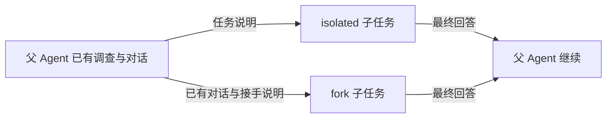
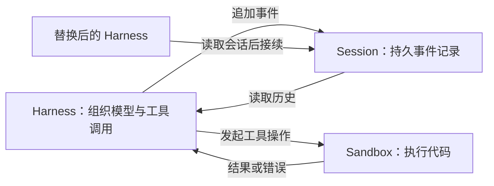

# Harness 与 Runtime：六篇原文精读

这六篇文章分别讨论分层、跨会话接续、质量反馈、多 Agent 上下文、托管执行架构，以及运行成本。它们共同回答一个问题：模型的一次推理，怎样变成能够持续推进、接受检查、处理故障的工作过程。

各篇的“原文要点”是压缩转述；“解释与推演”使用自拟案例分析机制，不代表作者做过相应实验。官方文档补充会单独标明。本文讨论文章所描述的设计；后续文档用于澄清机制，不把当前接口倒写成旧版本事实。

## 1. 按控制程度理解 Deep Agents、LangChain 与 LangGraph

**原文要点。** 三者在 LangChain 的产品体系中分别承担预置 harness、Agent 框架和运行时职责。Deep Agents 组合上下文管理能力，LangChain 提供模型与工具循环及中间件，LangGraph 承载底层执行。它们可以组合使用：选择入口，实际是在选择接受多少默认行为、自己控制多少过程。[原文：Deep Agents vs LangChain vs LangGraph](https://www.langchain.com/blog/deep-agents-vs-langchain-vs-langgraph)

**官方文档补充。** 文档将持久执行、流式事件、人工介入和状态保存归入 runtime；把模型、工具、循环等抽象归入 framework；把预设工具、提示、任务委派和上下文整理归入 harness。这是理解这一套产品的分类，不是所有厂商必须遵循的统一术语标准。[分层文档](https://docs.langchain.com/oss/python/concepts/products)

**解释与推演：用一个知识库助手区分三层。**

假设要做一个助手，既能回答“有哪些 runtime 文章”，也能持续阅读资料、整理笔记。

| 要作出的设计决定 | 例子 | 主要对应的职责 |
|---|---|---|
| 模型这一轮应该看到什么 | 给它检索结果摘要，还是十篇全文；何时派子任务 | Harness |
| 怎样表达与连接一次工作循环 | 接入模型与搜索工具，处理工具返回，再调用模型 | Framework |
| 工作怎样持续运行 | 记录执行位置；等待人工意见后继续；进程失败后恢复 | Runtime |

把这三种决定分开，就容易理解一种常见故障：助手每次都能回答，但第二天无法继续昨天的整理。问题可能出在状态持久化，增加一段“请记住进度”的提示未必解决。另一种情况是状态保存很可靠，却总把不相关文章塞进上下文；这时要调整的是信息选择策略。

需要注意，职责分开不等于必须有三个独立服务。它们可以在一个进程中，也可以通过不同库实现。这里的分类首先帮助定位“谁应该负责解决问题”。

**进一步推演：什么时候需要固定流程。**

“挑出最值得精读的文章”允许模型判断；“保存前必须包含原文链接”则可以由程序检查。如果每次保存都必须过这一检查，就应把它放在实际执行路径里。只把规则写进提示，仍要依赖模型记得执行。

LangGraph 允许把固定步骤与模型决定的步骤放进同一张图；图里的节点也可以是一个 Agent。[LangGraph 概览](https://docs.langchain.com/oss/python/langgraph/overview)

这张自拟示意图表达的是：局部可以自主探索，成果进入下一步的条件仍可明确规定。评估一种架构时，先找出哪些决定必须稳定，再判断需要多少自由度。

## 2. 让长期运行的智能体持续推进

**原文要点。** 文章针对跨上下文窗口的接续失败：工作铺得过大、留下半成品、过早宣布完成。初始化阶段建立功能清单、启动脚本、进度记录和初始提交；后续会话逐项实现、测试并交接。两个角色主要通过不同的初始提示区分，并不意味着两个 Agent 同时工作。这是面向 Web 开发的方案。[原文：Effective harnesses for long-running agents](https://www.anthropic.com/engineering/effective-harnesses-for-long-running-agents)

**官方示例补充。** 编码提示要求新会话先读取要求和进度，启动应用并复测已通过的核心流程；发现退化先修复，再选未完成功能。验收之后才更新通过状态、提交和交接。外层示例程序负责启动后续会话，因此“自动继续”与“怎样继续做对”分别落在程序和工作约定上。[编码提示](https://github.com/anthropics/claude-quickstarts/blob/main/autonomous-coding/prompts/coding_prompt.md)、[会话循环实现](https://github.com/anthropics/claude-quickstarts/blob/main/autonomous-coding/agent.py)

**解释与推演：接续需要恢复哪些信息。**

仍以知识库助手为例。上一轮只留一句“搜索基本完成”，下一轮无法据此判断中文正文搜索是否可用，也不知道索引是否会更新。

更有用的交接可以是：“文件名搜索已通过；中文正文搜索还失败。输入‘运行时’应找到指定笔记，实际为空。已确认文件载入正常，下一步检查分词。”

这段记录有价值，因为它保留了可复查的状态和下一步入口。可以把交接信息分成三类：

| 信息 | 应回答的问题 | 自拟例子 |
|---|---|---|
| 任务定义 | 还欠哪些可验收的能力 | 新增文章后应能检索到 |
| 改动证据 | 系统实际发生过什么变化 | 哪次提交加入索引更新 |
| 工作说明 | 为什么停在这里、从哪继续 | 更新事件触发正常，但索引写入失败 |

三类信息交叉核对，还能暴露记录与现实不一致。例如进度说“完成”，实际验收仍失败，就不能仅凭进度继续往下做。

**为什么重新开始时要先做小范围复测。**

设上一轮改了索引格式，却忘记更新读取逻辑。下一轮若直接开发过滤功能，会把错误叠加在坏基础上。先验证一个最基本的搜索流程，可以提前发现继承来的问题。

这可以看作交接时检查工作现场。它与完整回归测试的频率不是同一个问题：接续检查应当足够快，又能覆盖必须成立的前提。

**最容易误读的一点。**

外部记录有助于恢复任务理解，但不会自动保存内存里的对象、后台进程和未写入磁盘的结果。一个 Agent “知道自己上次在做什么”，与执行系统“能恢复上次的全部状态”是不同能力。前者在本篇中尤其突出，后者要继续看第五篇。

## 3. 长期应用开发的运行框架设计

**原文要点。** 作者让规划、生成和评估承担不同职责，并让评估者操作真实应用；同时强调评估者需要校准，另加一个模型不自动解决宽松评分。更关键的是设计演进：Opus 4.5 阶段撤掉显式上下文重置，改用连续会话与压缩；到 Opus 4.6 又撤掉 sprint，保留规划和完整构建后的 QA。DAW 案例仍经历三轮构建与检查。[原文：Harness design for long-running application development](https://www.anthropic.com/engineering/harness-design-long-running-apps)

**解释与推演：为什么“再检查一下”还不够。**

想象助手做了一个很漂亮的搜索页面。输入任何关键词，页面都会返回同样三篇文章。如果评审只看截图和开发者的完成说明，很容易把它当成能用的产品。

把评价要求改成可操作的行为，就会得到不同结果：输入不存在的词应显示空结果；新建一篇有特殊词的文章后应能搜到；删除文章后结果应消失。这些条件迫使检查触及数据流，而不是停在外观。

因此，一条有用反馈至少应说明观察到的行为、期望行为和复现条件。“搜索不太好”难以转成改动；“新文章加入后仍返回旧结果，刷新页面也不变”则能定位需要调查的链路。

**评估者也需要被检查。**

下面是一个自拟校准办法：给评估者三份刻意准备的版本，分别包含空结果错误、删除后残留、正常实现，检查它能否指出差异。若它总评为通过，继续增加评审轮次只会增加费用。

同样，开发者与评估者若都只拿到一份有缺陷的需求，双方一致也不能证明产品满足真实需求。角色分工的价值要通过发现了哪些问题来衡量，不能只数角色数量。

**为什么后半篇删掉流程比前半篇增加流程更重要。**

早期把长任务分段，可能是在弥补模型容易丢失目标的弱点。若模型已经能稳定完成更长的一段，每段都做一次完整交接和检查，就可能引入重复阅读、等待和打断。

由此可以形成一个工程判断：增加一道检查，应当减少足够多的遗漏或返工；减少一道检查，则应验证质量没有因此下降。这是需要实测的取舍，不存在对所有任务通用的固定角色数。

对于知识库助手，或许每次写入前检查链接即可，整批完成后再检查覆盖率；未必需要每读完一段就启动完整评审。具体边界应取决于任务成本与失败模式。

**阅读时要保留的边界。**

“完整构建后做 QA”描述检查放在哪里，不代表整个开发过程只能检查一次。也不能从更长时间、更高预算的作品更完整，直接推出同预算下多 Agent 一定优于单 Agent。文章提供了有价值的设计经验，但架构效果仍需要在相同任务和预算下比较。

## 4. 在多 Agent Harness 中组织共享与隔离上下文

**原文要点。** isolated 从任务描述开始新对话；fork 继承父 Agent 的对话背景。作者把延续已有工作的 worker 与需要独立判断的 reviewer 作为主要取舍场景。子任务通常把最终回答送回父对话。文中提出 fork 可能节省重新调查和缓存成本，但没有给出对照实验或固定收益。[原文：Organizing Context in a Multi-Agent Harness](https://www.langchain.com/blog/organizing-context-in-a-multi-agent-harness)

图只表示对话消息的流动，不表示文件或权限的隔离。

**官方实现补充。** isolated 仍可接收允许传播的其他状态；fork 会处理委派调用等消息，不能简单理解成逐字复制所有历史。子任务回传最终消息时，也可能回写允许传播的非私有状态。当前文档还说明 runtime context 会传给子 Agent。[子 Agent 文档](https://docs.langchain.com/oss/python/deepagents/subagents)、[原文所链固定版本实现](https://github.com/langchain-ai/deepagents/blob/15454a85438146a59c804af3a525f96091c55fe8/libs/deepagents/deepagents/middleware/subagents.py)

**解释与推演：用这次六篇精读来说明。**

假设主 Agent 已读完资料，形成一个初步判断：“所有长任务都应该分成固定阶段。”

把“根据已有材料写总览”交给 fork，通常方便：写作者需要那些资料和前面的讨论。

把“核查第三篇是否真的支持固定阶段”交给 isolated，则有另一种价值：只提供原文、待核查命题和判断标准，让核查者从证据出发。若同时传入主 Agent 大段自信的论证，就可能让核查者更倾向沿用已有结论。

这里的独立性不是少给必要材料。没有待审主张或原文链接，得到的可能只是信息不足。需要控制的是哪些背景会帮助任务，哪些背景可能无关或引导判断。

**成本为什么不能只看“有没有继承历史”。**

下面是自行构造的简化估算，不是产品计费公式。假设父历史有 10 万 token，缓存后的单位输入费用为普通输入的十分之一，那么继承输入约相当于 1 万普通输入 token 的费用。

如果独立任务只需补读 2000 token，fork 未必划算；如果需要重新读 8 万 token 并重复许多工具调用，fork 就可能更省。实际还要考虑缓存是否命中、输出长度、取证时间和回答质量。

缓存优惠也不会让继承内容在上下文窗口中消失。费用、长度和对判断的影响，是三个不同维度。

**权限是另一条线。**

一个看不到父对话的子 Agent，仍可能拿着同一组文件工具。因此“隔离对话”不能推出“不能改主任务文件”。官方权限文档也限定了内置文件规则的覆盖范围，不能把它自动扩展到任意自定义工具或 shell。[权限文档](https://docs.langchain.com/oss/python/deepagents/permissions)

由此得到的设计顺序是：先明确子任务需要什么证据，再决定继承哪些对话；同时单独决定它能读写什么、结果怎样回传。

## 5. 解耦代理执行、工具环境与会话状态

**原文要点。** Managed Agents 将 session 的持久追加事件日志、负责 Claude 与工具循环的 harness，以及可替换的 sandbox 分开。日志位于后两者之外，harness 可通过会话接口接续工作；sandbox 故障可成为工具结果。凭证通过资源集成、代理与 vault 隔离。文中描述恢复架构，没有承诺所有外部操作恰好发生一次。[原文：Scaling Managed Agents](https://www.anthropic.com/engineering/managed-agents)

这是职责示意图，不是完整的进程、存储或故障恢复实现图。

**解释与推演：任务的寿命为什么不该等于某个进程的寿命。**

假设知识库助手正在批量重建索引。若任务说明、已处理列表和下一步都只在一个容器的内存中，容器结束后，系统很难区分“还没开始”和“已经处理了一半”。

如果完成记录保存在独立的持久层，接手的执行者就能查看已确认的工作。执行者可以更换，任务仍有可核查的历史。这是把短暂执行与长期任务分开的直接价值。

但事件记录、磁盘文件和正在运行的进程仍是不同东西。日志写着“索引构建完成”，不能凭这一句话恢复没有保存的索引文件。讨论故障恢复时，应分别询问：哪些数据实际持久化、恢复到哪里、哪些操作需要重做。

**一个关键反例：恢复不等于不会重复操作。**

自拟故障时序如下：

1. Agent 请求外部系统创建一张问题工单。
2. 外部系统创建成功。
3. 成功结果尚未写入本地事件记录，harness 崩溃。
4. 接手者读日志，只看到请求，没有看到结果。

此时直接重试可能创建第二张工单。仅有持久日志无法消除这个“外部已成功、内部尚未知”的空隙。

业务设计可以用同一操作编号去重，或先向外部系统查询结果，再决定是否重试。这是对该架构边界的工程推演，文章没有说明已经用哪一种方式解决所有外部副作用。

**为什么 sandbox 只是 runtime 的一部分。**

在本文的解释口径中，sandbox 主要回答代码在哪里、带着什么能力运行；更完整的运行机制还要回答谁接收事件、谁记录进度、失败后谁重启、怎样继续。

当前官方文档把 Agent、Environment、Session、Events 作为公开产品概念；其会话状态还区分空闲、重新调度和终止。这说明托管运行不仅是提供一台机器，而且包含任务生命周期。公开产品概念与文章的内部三类职责不在同一层次。[产品概览](https://platform.claude.com/docs/en/managed-agents/overview)、[会话操作文档](https://platform.claude.com/docs/en/managed-agents/session-operations)

**延迟数字应怎样读。**

作者报告首 token 延迟的 p50 约下降 60%、p95 超过 90%，没有给出完整测量方法和绝对时长。[原文性能段](https://www.anthropic.com/engineering/managed-agents)

可作如下推演：如果先分析问题、真正需要工具时才准备执行环境，用户可能更早看到回应；但后续工具要运行十分钟，总任务耗时未必有同样比例的下降。首响应速度、任务完成时间和可靠性必须分别看。

## 6. Deep Agents 0.6 的执行、状态与记忆改进

**原文要点。** 这次更新组合了五项能力：解释器、按模型调整的 harness profiles、结构化流式事件、增量检查点以及版本化上下文存储。共同目标是减少长任务中不必要的模型往返、重复状态写入，以及跨运行管理上下文的成本。版本公告的性能说法需要结合其链接实验和具体负载理解。[原文：New in Deep Agents v0.6](https://www.langchain.com/blog/deep-agents-0-6)

**解释器：哪些工作可以留在模型之外。**

官方文档把解释器描述为循环内部的可编程工作区：代码组织工具调用并处理数据，只把需要的信息返回模型。它与提供操作系统能力的 sandbox 有不同职责；实际能调用哪些外部工具，需要单独配置。[解释器文档](https://docs.langchain.com/oss/python/deepagents/interpreters)

自拟例子：比较 100 篇文章的日期。逐篇把完整正文交给模型，会让大量与日期无关的信息进入上下文。另一种方式是模型先说明提取规则，程序取得页面、抽取日期、排序，并把缺失或冲突项交回来判断。

这并非取消推理，而是调整推理发生的位置。格式一致的排序交给程序；日期冲突意味着什么，再交给模型结合证据判断。若抽取程序本身有误，压缩后的结果也会错，因此应保留回查原始证据的入口。

**Profiles：换模型时，工具和提示可能也需要重新评估。**

官方 profile 配置可以调整系统提示、工具描述、可见工具和中间件等。它是配置层面的适配，不是修改模型权重。[Profiles 文档](https://docs.langchain.com/oss/python/deepagents/profiles)

推演一个公平的比较办法：用同一组知识库任务，分别记录模型更换前后的成功率、工具误用、返工次数和总费用。若新模型总误解某个工具，就先确认描述是否存在歧义。每 token 便宜并不必然意味着完成一项任务便宜。

**Streaming：长任务需要可辨认的过程。**

结构化流式事件能区分消息、工具与子任务进展。[v0.6 流式能力](https://www.langchain.com/blog/deep-agents-0-6)

对知识库整理，用户需要区分“仍在抓取”“正在核对日期”“某个来源失败”，才能决定是否介入。持续输出文字只证明有输出；明确的工作状态才有助于判断任务是否推进。这是产品交互层面的解释。

**Delta channels：省掉反复保存的旧内容。**

配套文章说明：普通步骤保存增量，每隔 K 步保存全量快照。Deep Agents 当时使用 K=50。其模拟的 200 轮多文件负载报告检查点存储约从 5.3 GB 降至 129 MB；实验使用模拟模型与内存 saver，没有真实模型调用。文中也明确承认，保留周期快照后，渐近增长仍有二次项。[Delta Channels 配套原文](https://www.langchain.com/blog/delta-channels-evolving-agent-runtime)

以下是便于理解的自行推导。假设每一步新增 s 单位数据，一共 N 步，而且所有历史检查点都保留：

- 每步全量保存，累计约为 s × (1 + 2 + … + N)，即 sN(N+1)/2。
- 每步只存增量，累计约为 sN，但从头恢复可能要重放很多步骤。
- 增量加每 K 步全量快照，累计量级约为 O(sN + sN²/K)。

因此，该设计在重复存储与恢复工作量之间作了取舍。K 大，完整快照少，但可能需要重放更多增量；K 小则相反。“最多回放约 K 步增量”也不意味着恢复任意大小的状态都只需同样时间，读取快照本身仍有成本。

这项优化针对检查点累计存储，不是把模型输入直接压缩了相同比例，也不能据此宣称所有真实任务都节省四十倍费用。

**Context Hub：保存进度与保存经验有什么不同。**

官方后端文档说明，文件写入会形成 Hub 提交；并发写入还可能遇到父提交过期，需要重新读取与处理冲突。[ContextHubBackend 文档](https://docs.langchain.com/oss/python/deepagents/backends)

自拟例子：“第 42 篇还没检查”是当前批次的进度；“这个来源的发布日期应读正文页首，不能读更新时间”则可能是下批任务仍适用的经验。两者寿命不同，验证方法也不同。

经验进入长期存储后会影响未来工作，所以保存时还应附上来源和适用范围。存得下来只保证它能被再次读取；是否正确、何时失效、发生冲突怎样选择，仍需要另外判断。

## 把六篇放回同一个工作过程

下面是基于六篇的综合推演，不是任何一篇原文给出的标准架构。

假设要让 Agent 连续几天完善知识库助手：首先划清模型可自主决定的步骤与程序必须检查的条件；再让每次工作留下可恢复的任务状态；用实际搜索行为验证成果；按子任务是否需要已有调查决定上下文；把任务记录与短暂执行环境分开；最后针对模型往返、检查点和长期经验分别优化。

| 出现的具体问题 | 优先调查什么 | 对应阅读 |
|---|---|---|
| 总把无关资料送进模型 | 上下文选择与工具策略 | 第 1 篇 |
| 新会话不知道该从哪继续 | 交接信息及其与现实的一致性 | 第 2 篇 |
| 页面漂亮，但关键操作不通 | 验收标准与反馈来源 | 第 3 篇 |
| 子任务重复调查，或照搬主任务误判 | 上下文继承方式 | 第 4 篇 |
| 进程结束后任务丢失，重试又可能重复操作 | 持久状态、恢复边界及业务去重 | 第 5 篇 |
| 任务越长，数据处理与存储成本越高 | 解释器、检查点和状态寿命 | 第 6 篇 |

这张表也说明，几个表面相似的问题可能有不同原因。“记不住”可能是没有持久化，也可能是持久化了却没有在下一轮读入；“无法继续”可能是没有交接，也可能是执行资源无法恢复。先识别失败发生在哪一层，才能选择有针对性的改动。

## 来源

六篇主文：

1. Sydney Runkle，LangChain，[Deep Agents vs LangChain vs LangGraph](https://www.langchain.com/blog/deep-agents-vs-langchain-vs-langgraph)，2026-08-06。
2. Justin Young，Anthropic，[Effective harnesses for long-running agents](https://www.anthropic.com/engineering/effective-harnesses-for-long-running-agents)，2025-11-26。
3. Prithvi Rajasekaran，Anthropic Labs，[Harness design for long-running application development](https://www.anthropic.com/engineering/harness-design-long-running-apps)，2026-03-24。
4. Thushanth Bengre、Chester Curme，LangChain，[Organizing Context in a Multi-Agent Harness](https://www.langchain.com/blog/organizing-context-in-a-multi-agent-harness)，2026-09-08。
5. Lance Martin、Gabe Cemaj、Michael Cohen，Anthropic，[Scaling Managed Agents: Decoupling the brain from the hands](https://www.anthropic.com/engineering/managed-agents)，2026-04-08。
6. Sydney Runkle，LangChain，[New in Deep Agents v0.6](https://www.langchain.com/blog/deep-agents-0-6)，2026-05-13。

补充材料（文档与可变仓库文件查阅于 2026-09-11）：

7. LangChain，[Runtimes, frameworks, and harnesses](https://docs.langchain.com/oss/python/concepts/products) 与 [LangGraph overview](https://docs.langchain.com/oss/python/langgraph/overview)，用于分层及执行机制。
8. Anthropic 官方示例，[coding_prompt.md](https://github.com/anthropics/claude-quickstarts/blob/main/autonomous-coding/prompts/coding_prompt.md) 与 [agent.py](https://github.com/anthropics/claude-quickstarts/blob/main/autonomous-coding/agent.py)，用于接续过程与外层循环。
9. LangChain，[Subagents](https://docs.langchain.com/oss/python/deepagents/subagents)、[Permissions](https://docs.langchain.com/oss/python/deepagents/permissions) 与 [固定提交中的子 Agent 实现](https://github.com/langchain-ai/deepagents/blob/15454a85438146a59c804af3a525f96091c55fe8/libs/deepagents/deepagents/middleware/subagents.py)，用于上下文、状态与权限边界。
10. Anthropic，[Managed Agents overview](https://platform.claude.com/docs/en/managed-agents/overview) 与 [Session operations](https://platform.claude.com/docs/en/managed-agents/session-operations)，用于当前产品概念和生命周期。
11. LangChain，[Interpreters](https://docs.langchain.com/oss/python/deepagents/interpreters)、[Profiles](https://docs.langchain.com/oss/python/deepagents/profiles) 与 [Backends](https://docs.langchain.com/oss/python/deepagents/backends)，用于解释器、适配配置和版本化存储。
12. Sydney Runkle，LangChain，[Delta Channels: Evolving our Runtime for Long-Running Agents](https://www.langchain.com/blog/delta-channels-evolving-agent-runtime)，2026-05-12，用于增量检查点机制、模拟实验条件与复杂度边界。
